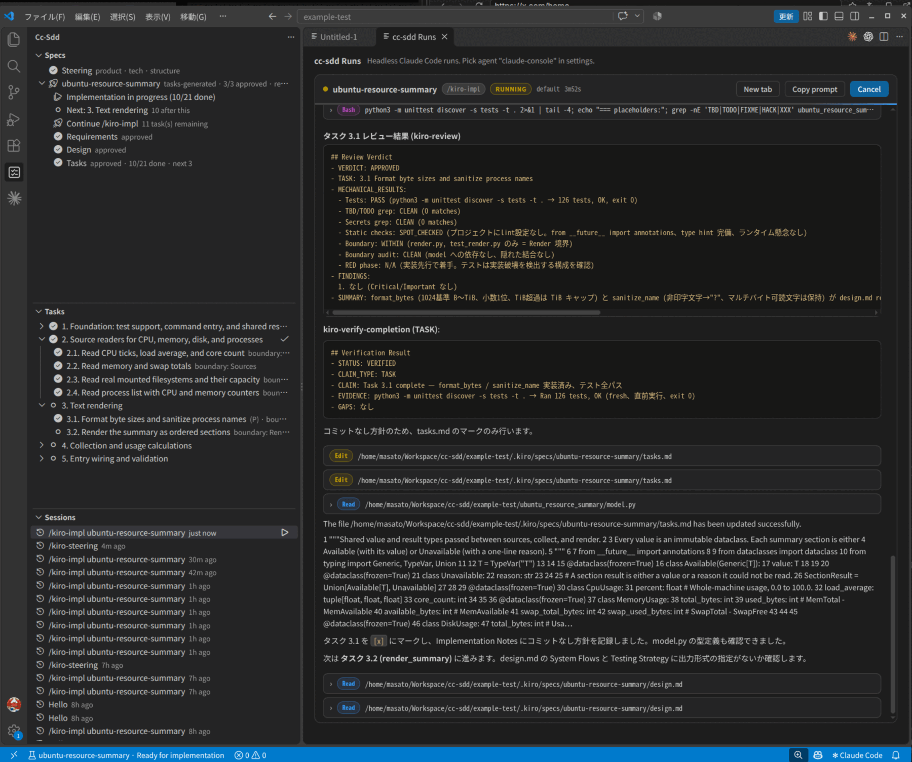

# cc-sdd Specs (VS Code extension)

<div align="center" style="margin-bottom: 1rem; font-size: 1.1rem;"><sub>
English | <a href="./README_ja.md">日本語</a>
</sub></div>

A VS Code workbench for [cc-sdd](https://github.com/gotalab/cc-sdd) specs. It reads `.kiro/specs/` directly and adds the missing UI layer: a spec explorer, approval gates, phase launchers, a task board, a headless **Runs** console, resumable Claude Code sessions, and a leader/PM **Overview** portfolio for spec progress.



The workbench is built around a Specs sidebar with embedded implementation tasks and a Sessions history timeline and two panels:

- **Specs, Tasks, Sessions** — the sidebar selects one spec, shows its Requirements → Design → Tasks → Implementation → Verification pipeline, and keeps task execution and session resume in the matching views.
- **Runs** — streams tool calls, markdown output, and progress in one panel. Permission prompts and `AskUserQuestion` appear as buttons there.
- **Overview** — A repository progress snapshot for reporting: total / in-progress / review / verification / attention / verified counts, recorded concerns, spec stages and implementation progress, and collapsed verified completions. Copy progress summary exports the current snapshot. Approvals and execution remain in Specs.

Architecture and internals (Japanese): **[docs/](./docs/README.md)**

Specs uses a theme-aware sidebar timeline with connected stage markers, implementation task progress, approval/run actions, and the five most recent runs in this window. Implementation tasks are embedded under each spec’s Implementation stage, with completed tasks folded away. The standalone Tasks view has been removed; Sessions uses the same monochrome timeline style: active sessions first, then history ordered by last activity, with details and resume actions on expansion. Expansion and reading position are preserved on refresh.

Runs uses one editor tab per run, titled with its spec and stage. Reopening a run or session reuses its tab. Closing a tab keeps the run available and does not cancel execution; use Cancel to stop it. `cc-sdd: Show Runs Console` opens a run picker with waiting runs first (or the only run directly). Session history also opens in its own tab.

## What it does

- **Full flow entry points** — `Run Discovery` starts `/kiro-discovery` (the correct entry for new work); the Specs timeline shows Steering presence (click to generate; use the Run button to re-run it after the codebase changes) and roadmap.md order/dependencies when they exist.
- **Spec Explorer** — lists every `.kiro/specs/<feature>` as a numbered Requirements → Design → Tasks → Implementation → Verification pipeline, with one explicit next action. Implementation completion is separate from spec completion: a spec is complete only when a current `impl-validation.md` records `GO`. Newest specs come first by default; set `ccSdd.specSort` to `roadmap` to follow roadmap.md dependency order instead.
- **Approval gates** — validates the artifact before recording an approval. Missing sections and unresolved `{{PLACEHOLDER}}` tokens block approval; softer issues require explicit confirmation.
- **Phase launcher** — runs `/kiro-spec-requirements`, `/kiro-spec-design`, `/kiro-spec-tasks`, and `/kiro-impl` in Claude Code, the Claude Code for VS Code panel, the headless Runs console, Codex, Copilot Chat, OpenCode, a custom command, or the clipboard.
- **Overview portfolio** — A repository progress snapshot for reporting: total / in-progress / review / verification / attention / verified counts, recorded concerns, spec stages and implementation progress, and collapsed verified completions. Copy progress summary exports the current snapshot. Approvals and execution remain in Specs.
- **Task board** — each spec’s Implementation stage contains its own tasks. Verification remains a separate stage, with start/revalidate/open-report actions. Completed tasks fold away; next, running, and waiting tasks are distinct. Run a single task, run the remaining tasks from a point, open the task in `tasks.md`, or open its active run.
- **Sessions** — initially scoped to the selected spec, with a toggle for all specs. Active/waiting sessions are separated from history; each item shows spec, stage (including verification), state, and last activity. Resume is offered for history sessions and open-run for active sessions with a matching run.
- **Run insights** — token usage (input / output / cache), per-turn metrics, permission denials, and a one-click trace export (`.kiro/runs/*.json`) for debugging.
- **Status bar** — shows the active spec and the shared next action, plus a `N waiting · M running` signal while runs are active.
- **Auto refresh** — watches the specs directory and reloads on changes.
- **Installer** — runs `npx cc-sdd@latest` with the integration you pick.
- **JSON Schema** — validates `.kiro/specs/*/spec.json` while you edit it.

Verification launches explicitly request an `impl-validation.md` evidence report with a `DECISION` line. A `spec.json` validation field alone remains unconfirmed and offers revalidation; a finished run alone does not mark a spec complete.

## State model

The extension treats `spec.json` as the single source of truth and only writes approval state:

```json
{
  "phase": "tasks-generated",
  "approvals": {
    "requirements": { "generated": true, "approved": true },
    "design": { "generated": true, "approved": true },
    "tasks": { "generated": true, "approved": false }
  },
  "ready_for_implementation": false
}
```

- Existing `phase` values (`initialized`, `requirements-generated`, `design-generated`, `tasks-generated`) are preserved.
- `ready_for_implementation` becomes `true` when all three approvals are `true`.
- Optional `blocked_reason` / `blockers` fields are shown as explicit blocks; the Overview never infers a block from age or past runs.
- Overview verification reads `impl-validation.md` (`DECISION: GO | NO-GO | MANUAL_VERIFY_REQUIRED`). A result older than the current artifacts is shown as stale, not verified.
- Writes use a temporary file and rename, so an interrupted save does not truncate `spec.json`.

## Commands

| Command | Description |
| --- | --- |
| `cc-sdd: Refresh` | Reload specs and tasks. |
| `cc-sdd: Run Discovery` | Describe the work and launch `/kiro-discovery` (the flow entry point). |
| `cc-sdd: Run Steering` | Launch `/kiro-steering` (also offered from the Steering node when missing, and from its Run button to re-run it). |
| `cc-sdd: Validate against Codebase (Gap)` | Launch `/kiro-validate-gap` for the active/selected spec (use the spec’s Gap check button). |
| `cc-sdd: Validate Design` | Launch `/kiro-validate-design` (use the spec’s Design check button). |
| `cc-sdd: New Spec` | Ask for a description and launch `/kiro-spec-init`. |
| `cc-sdd: Install Skills` | Pick an agent integration and run `npx cc-sdd@latest`. |
| `cc-sdd: Select Active Spec` | Choose the active spec and filter Sessions. |
| `cc-sdd: Show Spec Status` | Open a Markdown summary of phases and approvals. |
| `cc-sdd: Open Overview` | Open the leader / PM spec portfolio (also the dashboard icon in the Specs and Sessions title bars). |
| Approve / Revoke Phase | Buttons beside each timeline stage. |
| Run Phase | Context action on a missing/draft/generated phase. |
| Run Implementation | Context action on a ready spec. |
| Toggle Task | Flip a `tasks.md` checkbox from the tree. |

Internal commands (`ccSdd.openArtifact`, `ccSdd.openTask`, and so on) are hidden from the Command Palette and used by the tree views.

## Settings

| Setting | Default | Description |
| --- | --- | --- |
| `ccSdd.kiroDir` | `.kiro` | Directory containing `specs/` and `settings/`. |
| `ccSdd.agent` | `claude` | `claude`, `claude-vscode`, `claude-console`, `codex`, `copilot`, `opencode`, `custom`, or `clipboard`. |
| `ccSdd.customCommand` | empty | Terminal template for `custom`. Placeholders: `${prompt}`, `${skill}`, `${feature}`. |
| `ccSdd.consolePermissionMode` | `default` | Preselected permission mode for `claude-console` runs (`default` / `acceptEdits` / `bypassPermissions` / `plan`). `default` asks in the Runs console. A picker still asks per run. |
| `ccSdd.claudePath` | `claude` | Path to the claude CLI used for headless runs. |
| `ccSdd.installLanguage` | empty | Optional `--lang` value for the installer. |
| `ccSdd.autoRefresh` | `true` | Watch the specs directory for changes. |

### Agent invocation

| Agent | What the extension does |
| --- | --- |
| `claude` | Opens a terminal and runs `claude "/kiro-… <feature>"`. |
| `claude-vscode` | Prefills the prompt in the Claude Code for VS Code panel. It follows the extension's preferred location (sidebar or editor tab). Press Enter to run it. |
| `claude-console` | Runs headless via the Claude Agent SDK and streams progress in the **cc-sdd Runs** console. Permission requests and `AskUserQuestion` prompts appear as buttons inside the console, so requirements/design questions can be answered without leaving VS Code. |
| `codex` | Opens a terminal and runs `codex "$kiro-… <feature>"`. |
| `copilot` | Prefills the prompt in Copilot Chat (`workbench.action.chat.open`). |
| `opencode` | Opens a terminal and runs `opencode run "/kiro-… <feature>"`. |
| `custom` | Runs the `ccSdd.customCommand` template. |
| `clipboard` | Copies the prompt. Useful when the agent runs elsewhere. |

If Copilot Chat cannot be opened, the prompt is copied to the clipboard instead. The same fallback applies when the `claude-vscode` panel cannot be reached.

### Sessions

The **Sessions** view reads `~/.claude/projects/<encoded-workspace>/*.jsonl`, so only sessions whose recorded `cwd` matches the current workspace are listed (newest first). Hovering shows the last assistant message to jog your memory; clicking a session opens a **read-only preview** of the full transcript in the Runs console. The same card has a continuation input and a permission-mode selector: **Resume in console** continues the session **in place** (no extra dialogs), and **Terminal** launches `claude --resume`. The context-menu action also offers:

- **Resume in Runs console** — continues the same session headlessly (Claude Agent SDK `resume`), with the usual permission picker. The stored transcript is replayed as a **Session history** block above the live output.
- **Resume in terminal** — runs `claude --resume <session-id>` interactively.
- **Open raw transcript** / **Copy session id** — for inspection or scripting.

### Overview portfolio

A repository progress snapshot for reporting: total / in-progress / review / verification / attention / verified counts, recorded concerns, spec stages and implementation progress, and collapsed verified completions. Copy progress summary exports the current snapshot. Approvals and execution remain in Specs.

- Counts overlap: review, verification and attention are subsets, not additional work.
- Concerns include explicit blocks, failed/manual/stale/unconfirmed/unavailable verification and metadata errors.
- Click a spec to inspect artifacts; verified completions link to their reports. No approval or execution controls are offered here.
- Local runs, inferred dependency candidates, elapsed-age guesses and task-based overall completion percentages are excluded from reporting. Recent updates and Dependencies & candidates are no longer displayed.

## Workspace scope

The MVP follows the first workspace folder. Use `ccSdd.kiroDir` to point at a different specs root inside that folder. Multi-root support is a future candidate.

## Run from source

```bash
git clone https://github.com/Tomatio13/cc-sdd-vscode-extension.git
cd cc-sdd-vscode-extension
npm install
npm run build
npm test
```

Then open the repository folder in VS Code and press <kbd>F5</kbd>. The included `.vscode/launch.json` starts an Extension Development Host.

To try it against a project, open any folder that contains `.kiro/specs/<feature>/spec.json`. The extension reads that folder directly; it does not need to be this repository.

Package a VSIX with:

```bash
npm run package
```

## Design boundaries

- **Generation belongs to the agent.** The extension never calls a model. It invokes the skill and lets the host own tools, permissions, and model choice.
- **Approval belongs to the extension.** The gate validation is deterministic and local.
- **The storage format is shared.** Kiro, Claude Code, Codex, Copilot, and the other cc-sdd hosts can keep using the same `.kiro/specs` directory.
- **VS Code compatible.** The extension uses public VS Code APIs plus a guarded built-in command for Copilot Chat, so it can also run in Kiro, Cursor, Windsurf, and VSCodium via Open VSX.

## Not yet implemented

Still on the roadmap in [plan.md](https://github.com/gotalab/cc-sdd/blob/main/plan.md): Codex / OpenCode headless adapters, subagent execution control inside the extension, durable run history for exact cross-window state, task-level Kanban, and the Code OSS fork evaluation.

## License

MIT
