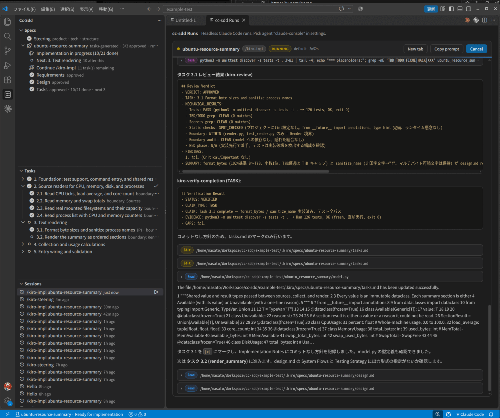
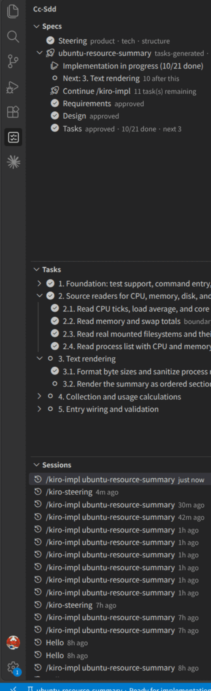

# cc-sdd Specs（VS Code 拡張機能）

[cc-sdd](https://github.com/gotalab/cc-sdd) の specs を VS Code 上で扱うワークベンチです。`.kiro/specs/` を直接読み取り、足りなかった UI レイヤー（spec explorer、承認ゲート、フェーズランチャー、タスクボード、headless な **Runs** コンソール、Claude Code セッションの再開）を追加します。

<div align="center" style="margin-bottom: 1rem; font-size: 1.1rem;"><sub>
<a href="./README.md">English</a> | 日本語
</sub></div>

これは [plan.md](https://github.com/gotalab/cc-sdd/blob/main/plan.md) の **L1 + L2** 実装に、L3 の最初のスライスを加えたものです。承認と状態遷移は拡張側に保持し、スキルの呼び出しはあなたが使っているエージェント（ターミナル / Claude Code for VS Code パネル / 内蔵の headless Runs コンソール = Claude Agent SDK）に任せます。cc-sdd のスキル本体は cc-sdd インストーラ（`npx cc-sdd@latest --claude-skills`）が入れます。拡張はその上の UI レイヤーです。

設計・内部構造のドキュメント: **[docs/](./docs/README.md)**



<div align="center"><sub>左に Specs / Tasks / Sessions。右の cc-sdd Runs コンソールはツール呼び出し・Markdown 出力・進捗をストリーミング表示し、権限確認と <code>AskUserQuestion</code> は同じパネル内のボタンで回答できます。</sub></div>

## フローの対応範囲

Discovery → Steering → spec 生成 → 承認 → 実装 → 検証、までを VS Code の UI から完結できます。

| cc-sdd のフロー | 拡張での対応 |
| --- | --- |
| `/kiro-discovery` | ✅ Specs ビューの 🧭 ボタン / `cc-sdd: Run Discovery`（説明を入力 → 実行。空で Enter なら既存 brief / roadmap からの再開をスキルに任せる） |
| Steering（product / tech / structure） | ✅ Spec ツリーの Steering ノード。未生成ならクリックで `/kiro-steering` 実行、生成済みならクリックで product.md を開く |
| `/kiro-spec-init` | ✅ `cc-sdd: New Spec` |
| `/kiro-spec-requirements` / `design` / `tasks` | ✅ Run Phase（フェーズノードの ▶）。生成物の状態表示とファイルオープン |
| 承認ゲート | ✅ ✓ Approve / 取消。承認フラグと `ready_for_implementation` のみ書き込む |
| `/kiro-impl` | ✅ `Continue /kiro-impl` / Run Implementation。進捗は tasks の `[x]` から表示 |
| `/kiro-validate-impl` | ✅ `Validate implementation` ノード / `cc-sdd: Run Implementation Validation` |
| `/kiro-spec-status` | ✅ `cc-sdd: Show Spec Status`（Markdown レポートを開く） |
| `/kiro-validate-gap` / `validate-design` | ✅ spec 右クリックから実行 |
| セッション再開 | ✅ **Sessions** ビュー。現在のワークスペースのセッションだけを一覧（トークン量・推定コスト付き）し、Runs コンソール / ターミナルで resume |
| `/kiro-spec-batch` | ⚠️ roadmap.md の依存順で Spec 一覧を並べ替え・依存表示までは対応。batch 実行自体はスキル側 |
| `/kiro-spec-quick` / `review` / `debug` / `verify-completion` | ⚠️ 起動 UI なし。セッション内で完結するワークフローのため（review は plugin の `kiro-reviewer` サブエージェントで補完可） |

## 何ができるか



- **Spec Explorer** — `.kiro/specs/<feature>` をフェーズと承認状況込みで一覧。roadmap があれば依存順に並べ替え、`deps:` バッジ付き
- **Steering / Roadmap ノード** — `.kiro/steering/` の生成状況と roadmap.md への入口。roadmap.md は `## Specs (dependency order)` をパースする
- **Approval gates** — 承認前に成果物を検証。必須セクションの欠落や未解決の `{{PLACEHOLDER}}` は承認をブロックし、より軽い問題は明示的な確認が必要
- **Phase launcher** — `/kiro-spec-requirements`、`/kiro-spec-design`、`/kiro-spec-tasks`、`/kiro-impl`、`/kiro-validate-*` を Claude Code / Codex / Copilot Chat / OpenCode / カスタムコマンド / クリップボードで実行
- **Task board** — `tasks.md` のチェックボックス、`(P)`、`_Boundary:_`、`_Depends:_`、`_Requirements:_` をツリー表示。エディタを開かずにタスクを切替
- **Status bar** — アクティブ spec と次のアクションを常時表示
- **Auto refresh** — `.kiro/` 配下を監視し、変更時に再読込。フォーカス復帰時と spec 配下の保存時にも再検証
- **Installer** — 好きな統合を選んで `npx cc-sdd@latest` を実行
- **JSON Schema** — `.kiro/specs/*/spec.json` の編集を検証

## 状態モデル

拡張は `spec.json` を唯一の状態源として扱い、書き込むのは承認状態だけです。

```json
{
  "phase": "tasks-generated",
  "approvals": {
    "requirements": { "generated": true, "approved": true },
    "design": { "generated": true, "approved": true },
    "tasks": { "generated": true, "approved": false }
  },
  "ready_for_implementation": false
}
```

- 既存の `phase` 値（`initialized`、`requirements-generated`、`design-generated`、`tasks-generated`）は維持
- 3 つの承認がすべて `true` になると `ready_for_implementation` が `true`
- 書き込みは一時ファイル + rename のため、中断されても `spec.json` が壊れない

## コマンド

| コマンド | 説明 |
| --- | --- |
| `cc-sdd: Refresh` | specs と tasks を再読込 |
| `cc-sdd: Run Discovery` | 説明を入力して `/kiro-discovery` を起動 |
| `cc-sdd: Run Steering` | `/kiro-steering` を起動（Steering ノードをクリックでも可） |
| `cc-sdd: Validate against Codebase (Gap)` | 選択中 spec で `/kiro-validate-gap` を起動（spec 右クリック） |
| `cc-sdd: Validate Design` | `/kiro-validate-design` を起動（spec 右クリック） |
| `cc-sdd: New Spec` | 説明を入力して `/kiro-spec-init` を起動 |
| `cc-sdd: Install Skills` | 統合先を選んで `npx cc-sdd@latest` を実行 |
| `cc-sdd: Select Active Spec` | Tasks ビューが追従する spec を選択 |
| `cc-sdd: Show Spec Status` | フェーズと承認の Markdown サマリを開く |
| Approve / Revoke Phase | フェーズノードのコンテキストアクション |
| Run Phase | 未生成 / draft / review のフェーズのコンテキストアクション |
| Run Implementation | 実装可能な spec のコンテキストアクション（🚀） |
| Run Implementation Validation | `/kiro-validate-impl` を起動 |
| Toggle Task / Open Task | `tasks.md` のチェックボックスをツリーから切替 / 該当行を開く |

内部コマンド（`ccSdd.openArtifact`、`ccSdd.openTask` など）はコマンドパレットから隠してあり、ツリービューが使用します。

## 設定

| 設定 | 既定値 | 説明 |
| --- | --- | --- |
| `ccSdd.kiroDir` | `.kiro` | `specs/` と `settings/` を含むディレクトリ |
| `ccSdd.agent` | `claude` | `claude` / `claude-vscode` / `claude-console` / `codex` / `copilot` / `opencode` / `custom` / `clipboard` |
| `ccSdd.customCommand` | 空 | `custom` 時のターミナルコマンドテンプレート。`${prompt}`、`${skill}`、`${feature}` が使用可 |
| `ccSdd.consolePermissionMode` | `default` | `claude-console`(headless 実行)の既定権限モード(`default` / `acceptEdits` / `bypassPermissions` / `plan`)。`default` は Runs コンソール内で確認する。実行ごとに選択画面が出る |
| `ccSdd.claudePath` | `claude` | headless 実行で使う claude CLI のパス |
| `ccSdd.installLanguage` | 空 | インストーラに渡す `--lang` 値（例: `ja`） |
| `ccSdd.autoRefresh` | `true` | specs ディレクトリの変更を監視 |

### エージェント呼び出し

| エージェント | 動作 |
| --- | --- |
| `claude` | ターミナルで `claude "/kiro-… <feature>"` を実行 |
| `claude-vscode` | Claude Code for VS Code のパネルにプロンプトを補完。拡張側の preferred location（サイドバー or エディタタブ）に追従。Enter で実行 |
| `claude-console` | Claude Agent SDK 経由で headless 実行し、**cc-sdd Runs** コンソールに進捗をストリーミング表示。権限確認と `AskUserQuestion` はコンソール内のボタンで回答できる(requirements / design の質問も VS Code 内で完結) |
| `copilot` | Copilot Chat にプロンプトを流し込む |
| `opencode` | ターミナルで `opencode run "/kiro-… <feature>"` を実行 |
| `custom` | `ccSdd.customCommand` のテンプレートを実行 |
| `clipboard` | プロンプトをコピー（エージェントを別画面で使う場合） |

Copilot Chat を開けない場合は、プロンプトをクリップボードにコピーします。

### Sessions

**Sessions** ビューは `~/.claude/projects/<encoded-workspace>/*.jsonl` を読み、記録された `cwd` が現在のワークスペースと一致するセッションだけを新しい順に表示します。ホバーで最後のアシスタント発話を確認でき、**クリックするとトランスクリプト全体の読み取り専用プレビュー**が Runs コンソールに開きます。同じカード内の継続メッセージ入力欄と権限モード選択から **Resume in console** を押すと、**その場で**ライブ実行に切り替わります(追加ダイアログなし)。**Terminal** ボタンは `claude --resume` を起動します。右クリックメニューには以下もあります:

- **Resume in Runs console** — 同じセッションを headless で継続(Claude Agent SDK の `resume`)。権限モードは通常どおり選択。保存済みのトランスクリプトは **Session history** ブロックとして表示され、過去のやり取りがそのまま読めます
- **Resume in terminal** — `claude --resume <session-id>` を対話ターミナルで起動
- **Open raw transcript** / **Copy session id** — 調査・スクリプト用

## ワークスペースのスコープ

MVP は最初のワークスペースフォルダに追従します。同じフォルダ内の別の specs ルートには `ccSdd.kiroDir` を使用してください。マルチルート対応は Phase 3 の候補です。

## ソースから実行

```bash
cd tools/cc-sdd-vscode
npm install
npm run build
npm test
```

VS Code で `tools/cc-sdd-vscode` をワークスペースとして開き <kbd>F5</kbd> を押すと、同梱の `.vscode/launch.json` が Extension Development Host を起動します。

試すには `.kiro/specs/<feature>/spec.json` を含むフォルダを開いてください。リポジトリ自身の `.kiro/specs/`（`photo-albums-en` など）が fixture として使えます。

VSIX の作成:

```bash
npm run package
```

## 設計の境界

- **生成はエージェントの仕事。** 拡張はモデルを呼ばず、スキルを起動し、ツール・権限・モデルの選択はホストに任せる
- **承認は拡張の仕事。** ゲート検証は決定的でローカルに完結する
- **ストレージ形式は共有。** Kiro、Claude Code、Codex、Copilot など cc-sdd ホストは同じ `.kiro/specs` を使い続けられる
- **VS Code 互換。** 公開 API と Copilot Chat 用の組み込みコマンドを使うため、Kiro / Cursor / Windsurf / VSCodium でも Open VSX 経由で動作する

## 未対応

[plan.md](https://github.com/gotalab/cc-sdd/blob/main/plan.md) の Phase 3 以降: headless CLI ランナーのストリーミング進捗（Claude Code / Codex / OpenCode アダプタ）、拡張内でのサブエージェント実行制御、Code OSS fork の検討。

## ライセンス

MIT
