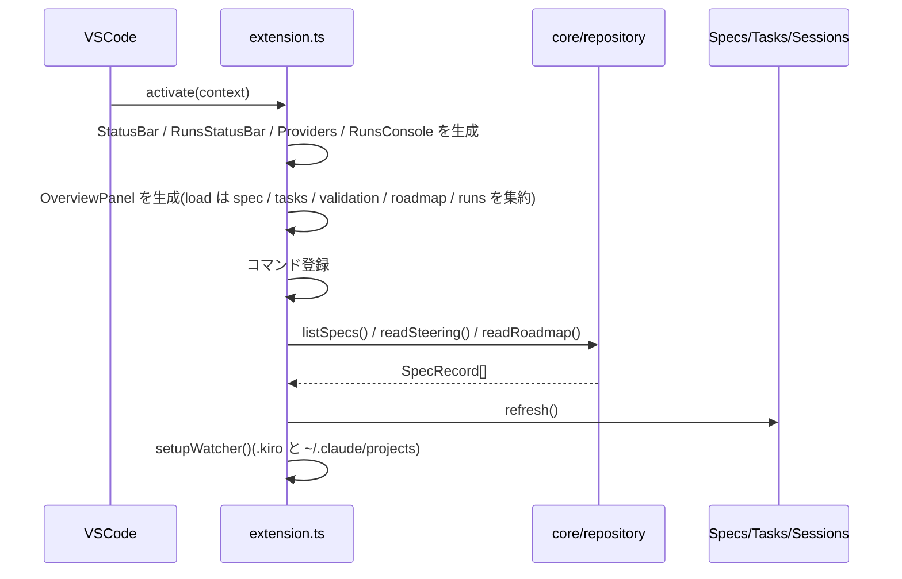

# アーキテクチャ

## 設計原則

1. **状態の唯一の源は `spec.json`**
   拡張は `approvals.*.approved` と `ready_for_implementation` だけを書き、`phase` などの値を勝手に増やさない。
2. **生成はエージェント、承認と状態遷移は拡張**
   拡張は LLM を自前で持たない(内蔵 Runs コンソールも Claude Agent SDK 経由で既存の `claude` CLI に委譲する)。
3. **core は VS Code に依存しない**
   純粋ロジックは `src/core/` に置き、ユニットテスト(vitest)で検証する。`vscode` を import するのは `ui/`・`launch/`・`run/`・`extension.ts` のみ。
4. **UI はネイティブ優先、ライブ表示とダッシュボードだけ Webview**
   Specs / Tasks / Sessions は Tree View。Webview は Runs コンソール(ログのストリーミングとリッチ表示)と Overview ポートフォリオ(KPI / spec 進捗)の 2 つ。

## レイヤと依存方向

```text
extension.ts  ←  composition root(コマンド登録・監視・DI)
  ├─ ui/         Specs / Tasks / Sessions ツリー、StatusBar、Runs コンソール、
  │              Overview ポートフォリオ / Runs ステータスバー
  ├─ launch/     runSkill: エージェント別の起動振り分け
  ├─ run/        Claude Agent SDK ランナー(イベント変換・権限コールバック)
  └─ core/       spec / tasks / validation / phases / repository / invocation / sessions / overview
```

依存は `extension → ui/launch/run → core` の一方向。`core` から `vscode` へは依存しない。

## ディレクトリ構成

| パス | 役割 |
| --- | --- |
| `src/extension.ts` | エントリポイント。プロバイダ生成、コマンド登録、ファイル監視、RunsConsole へのコールバック注入 |
| `src/core/spec.ts` | `spec.json` の型・正規化・承認更新・次アクション判定 |
| `src/core/tasks.ts` | `tasks.md` のパース(チェックボックス・メタデータ・ツリー化・チェック反転) |
| `src/core/validation.ts` | 承認ゲート(error / warning の判定) |
| `src/core/phases.ts` | フェーズ ↔ 成果物ファイル ↔ スキル名の対応 |
| `src/core/repository.ts` | `.kiro` 配下の読み書き(原子的書き込み)、steering / roadmap の解析 |
| `src/core/invocation.ts` | エージェント別のプロンプト/ターミナルコマンド生成 |
| `src/core/sessions.ts` | Claude Code セッションの列挙・ヘッド/テイル読取・トランスクリプト変換・活動状態の推定 |
| `src/core/overview.ts` | Overview の純粋な集約ロジック(`OverviewModel` / KPI / Spec 表 / 依存 / イベント) |
| `src/core/progress.ts` | Specs / Tasks / Overview 共通の工程・状態・検証・完了判定 |
| `src/launch/agentLauncher.ts` | `runSkill()`: エージェント別の起動処理とフォールバック |
| `src/run/claudeRunner.ts` | Claude Agent SDK のラッパー。`RunEvent` / `RunState` / 権限コールバック |
| `src/ui/specTree.ts` | Specs ツリー(Steering / roadmap / spec / 5 工程 / 次アクション) |
| `src/ui/taskTree.ts` | Tasks ツリー(選択 Spec の実装・完了・検証) |
| `src/ui/sessionsTree.ts` | Sessions ツリー(選択 Spec の scope / active / history) |
| `src/ui/statusBar.ts` | アクティブ spec と次アクションの表示 |
| `src/ui/runsStatusBar.ts` | ローカル run の `N waiting · M running` 表示(クリックで Runs コンソール) |
| `src/ui/runsConsole.ts` | Runs コンソール(Webview)。パネル管理・HTML/CSS/JS・メッセージ処理 |
| `src/ui/overviewPanel.ts` | Overview ポートフォリオ(Webview)。KPI / Spec 表 / 依存 / イベント / 完了セクション |
| `schemas/spec.schema.json` | `spec.json` の JSON Schema(`jsonValidation` で適用) |
| `test/` | vitest ユニットテスト(core / runner / sessions / overview) |

## 起動シーケンス

`activationEvents`: `workspaceContains:**/.kiro/specs/*/spec.json`, `onView:ccSdd.specs`, `onCommand:ccSdd.refresh`



## 更新(リフレッシュ)のトリガー

| トリガー | 実装 |
| --- | --- |
| `.kiro/**` の作成/変更/削除 | `FileSystemWatcher`(`ccSdd.autoRefresh` で無効化可) |
| `~/.claude/projects/<project>/*.jsonl` の変更 | 同 Watcher(Sessions 用) |
| `.kiro` 配下のファイル保存 | `onDidSaveTextDocument` |
| ウィンドウフォーカス復帰 | `onDidChangeWindowState`(外部プロセスによる変更の取りこぼし対策) |
| 設定変更 | `onDidChangeConfiguration` |
| ワークスペース変更 | `onDidChangeWorkspaceFolders` |

いずれも `scheduleRefresh()`(150ms デバウンス)を経て `refresh()` が走り、Specs / Tasks / StatusBar / Sessions をまとめて更新します。Overview を開いている場合は `overviewPanel.scheduleRefresh(150)` も呼び、ボードを再集約します。

Runs の状態変化はファイル監視とは別経路です。`RunsConsole.updateAll()`(80ms 合流)が `onDidChange` を発火し、`extension.ts` が

1. `runsStatusBar.update(runsConsole.getRuns())`
2. `overviewPanel.scheduleRefresh()`(350ms デバウンス)

を実行します。Overview の読み込みは spec / tasks / validation / roadmap / runs を毎回読みます。

## ワークスペースの扱い

MVP は**最初のワークスペースフォルダ**のみ対象(`workspaceFolders[0]`)。`.kiro` の位置は `ccSdd.kiroDir`(既定 `.kiro`、絶対パス可)。

## 拡張ポイント

| やりたいこと | 触る場所 |
| --- | --- |
| エージェントを追加 | `core/invocation.ts` の `AgentKind` + `buildInvocation`、`launch/agentLauncher.ts` の分岐、`package.json` の `ccSdd.agent` enum |
| ツリービューを追加 | `package.json` の `contributes.views` + `menus`、`ui/` に Provider、`extension.ts` で `registerTreeDataProvider` |
| フェーズ/スキルを追加 | `core/spec.ts` の `PHASES`、`core/phases.ts` の `PHASE_META`、`core/validation.ts` |
| Runs の事後アクションを増やす | `RunsConsoleOptions.getPhaseActions()`、Webview の `renderActions()` |
| Overview の指標 / 表 / イベントを増やす | `core/overview.ts` の `buildOverview()`、`ui/overviewPanel.ts` の `renderKpis()` / `renderInProgress()` / `renderEvents()` |
| セッションの表示項目を増やす | `core/sessions.ts` の `SessionRecord` / `readSessionHead`、`ui/sessionsTree.ts` || セッションの活動判定を変える | `core/sessions.ts` の `readSessionTailInfo()`(停止マーカー・`AskUserQuestion`・猶予時間) |
