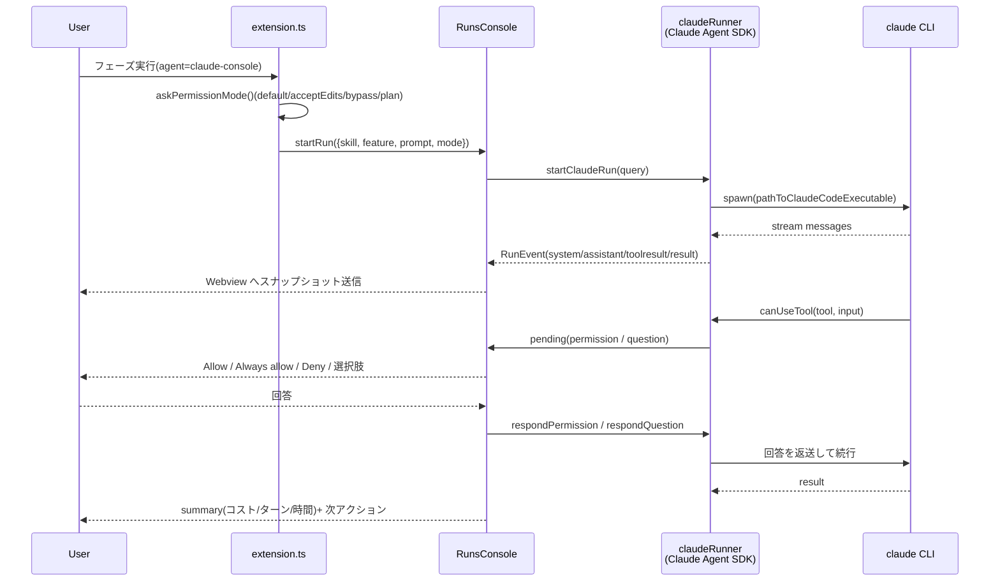

# エージェント呼び出しと Runs コンソール

## エージェントモード(`ccSdd.agent`)

`runSkill()`(`launch/agentLauncher.ts`)が設定に応じて起動方法を切り替えます。

| 値 | 動作 |
| --- | --- |
| `claude` | 新規ターミナルで `claude "/kiro-… <feature>"` を実行(Enter まで自動) |
| `claude-vscode` | Claude Code for VS Code パネルの composer にプロンプトを**補完**(自動送信はしない) |
| `claude-console` | 内蔵 **Runs コンソール**で headless 実行(Claude Agent SDK)。権限確認と `AskUserQuestion` をコンソール UI で処理 |
| `codex` | ターミナルで `codex "$kiro-… <feature>"` |
| `copilot` | `workbench.action.chat.open` で Copilot Chat にプロンプトを流し込む |
| `opencode` | ターミナルで `opencode run "/kiro-… <feature>"` |
| `custom` | `ccSdd.customCommand` のテンプレート(`${prompt}` / `${skill}` / `${feature}`) |
| `clipboard` | プロンプトをクリップボードへ |

プロンプト生成は `core/invocation.ts`。Claude 系は `/skill feature`、Codex は `$skill feature`。

### claude-vscode のフォールバック

1. `vscode.commands.executeCommand('claude-vscode.editor.open', undefined, prompt, …, { programmatic: 'honor-preferred-location' })`
2. 失敗時: URI `vscode://anthropic.claude-code/open?prompt=…` を `env.openExternal`
3. 失敗時: クリップボードへコピー + 警告

`honor-preferred-location` により、Claude Code 拡張側で「Open in Side Bar」を好みにしていればサイドバーへ流れます。

## Runs コンソール(`claude-console`)

### 全体フロー

### SDK 統合(`run/claudeRunner.ts`)

`startClaudeRun(options)` が `query()` を呼びます。

| オプション | 値 |
| --- | --- |
| `prompt` | `/skill feature`(または再開時の継続メッセージ) |
| `cwd` | ワークスペースルート |
| `permissionMode` | `default` / `acceptEdits` / `bypassPermissions` / `plan` |
| `canUseTool` | 権限・質問コールバック(下記) |
| `pathToClaudeCodeExecutable` | `ccSdd.claudePath` を PATH から解決した絶対パス |
| `resume` | セッション再開時の session id |

補足:

- SDK は `claude` CLI を子プロセスとして使う。拡張は SDK を esbuild でバンドルするが、CLI はユーザー環境のものを使う(認証・設定を共有)
- `--dangerously-skip-permissions` は使わない。`bypassPermissions` は SDK の permission mode で指定
- `bypassPermissions` では SDK が `canUseTool` を呼ばない(警告が出る)。それ以外では呼ばれる

### 権限と質問(`canUseTool`)

- `AskUserQuestion` の場合
  - `input.questions` を検証して `AskUserQuestionSpec[]` に変換(選択肢 0 件の質問は無視)
  - `RunEvent { kind: 'pending', pending: { kind: 'question', questions } }` を発火して Promise で待機
  - UI が回答(question → label のマップ)を返すと `{ behavior: 'allow', updatedInput: { ...input, answers } }`
- その他のツールの場合
  - 実行中の許可セット(`always allow` で追加)に含まれれば即 allow
  - それ以外は `pending { kind: 'permission', toolName, summary }` を発火して待機
  - `deny` → `{ behavior: 'deny', message }`、`always` → セットに追加して allow
- キャンセル時は保留中の Promise を `deny` で解決し、`query.interrupt()` を呼ぶ

### イベントと状態

`RunEvent`(SDK メッセージ → 内部表現):

| SDK メッセージ | RunEvent |
| --- | --- |
| `system` (`subtype: init` のみ) | `{ kind: 'system', sessionId, model }`(hook 等の system は無視) |
| `assistant` の `text` ブロック | `{ kind: 'assistant', text }` |
| `assistant` の `tool_use` ブロック | `{ kind: 'assistant', tool: { name, summary } }` |
| `user` の `tool_result` ブロック | `{ kind: 'toolresult', text, isError }` |
| `result` | `{ kind: 'result', isError, text, costUsd, turns, durationMs }` |

`RunState`: `status`(`running` / `done` / `error` / `cancelled` / `preview`)、`segments`、`summary`、`pending`、`history`、`preview`。

上限:

| 対象 | 上限 |
| --- | --- |
| ログ segment 数 | 600(古いものから破棄) |
| ツール結果 1 件 | 1,200 文字 |
| 最終結果 | 4,000 文字 |
| 履歴(セッション) | 1,500 エントリ |

### 実行状態はどう決まるか

- `result` メッセージで `summary.isError = is_error || subtype !== 'success'` を決める
- ストリームが終了したら `onExit(exitCode, interrupted)`:
  - `interrupted`(Cancel)→ `cancelled`
  - `exitCode === 0 && !summary.isError` → `done`
  - それ以外 → `error`
- **`result` が来ずにストリームが閉じた場合は ERROR**(「done なのに summary が無い」を防ぐ)
- `stop_reason` は状態判定には使わず、`end_turn` 以外のときサマリに `stop: max_tokens` のような警告チップを表示する

### Webview プロトコル(`ui/runsConsole.ts`)

**host → webview**

| type | 内容 |
| --- | --- |
| `state` | `RunState[]` のスナップショット。**`history` は含めない**(転送量削減) |
| `history` | `{ runId, segments }`。run ごと・パネルごとに**一度だけ**送信 |

**webview → host**

| type | 内容 |
| --- | --- |
| `ready` | 初期化完了。スナップショット+履歴を要求 |
| `cancel` / `rerun` / `close` / `popout` | 実行制御。`popout` は run 専用タブを開く |
| `copy` / `openArtifact` | クリップボード / ファイルを開く |
| `permission` | `{ pendingId, decision: allow \| always \| deny }` |
| `answer` | `{ pendingId, labels: string[] }`(質問への回答) |
| `approve` / `runPhase` / `runImpl` | 実行後のフェーズ操作 |
| `clearFinished` | 完了 run をまとめて削除 |
| `resumeConsole` / `resumeTerminal` | プレビューカードからのセッション再開 |

その他:

- パネルは「メイン(全 run)」+「run ごとのポップアウトタブ」。`panels: Map<WebviewPanel, runId | undefined>` で管理
- 更新は 80ms で合流(`updateAll` のタイマー)
- Webview の CSP は nonce 付き。`style-src` のみ `'unsafe-inline'` を許可
- 履歴は「プレビュー/再開時のみ」。展開時に遅延レンダリングし、HTML 文字列をキャッシュ

### コンソールの描画

- ツール呼び出しはカテゴリ別チップ(`Read` / `Write` / `Bash` / `Search` / `Agent` / `Web`)+ 折りたたみ結果
- アシスタント出力はミニ Markdown(見出し・箇条書き・表・コードブロック・インラインコード・太字)
- 実行中は進捗バー + ライブ経過時間、待機中は `WAITING FOR YOU`
- 完了時は `RUN FINISHED` カード(コスト・ターン数・実行時間)
- 承認ゲートを通過したフェーズでは `Approve …` / `Run next: …` / `Run implementation` を表示(`getPhaseActions`)

### 完了後の継続(Continue)

完了した run のカードには、そのセッションに追記する入力欄が出ます(明示的に `Close` するまで)。`Send`(または Enter)で `resume: <sessionId>` の新しいクエリを同じカード内で開始し、ログと usage を引き継ぎます。エージェントが本文テキストで質問を返した場合も、そのまま回答して作業を続けられます(AskUserQuestion の選択肢カードが出ている場合はそちらで回答)。

### 使用量とデバッグ

- `result.modelUsage`(全モデル合計)を権威値として、入力 / 出力 / キャッシュ(読み取り・書き込み)/ コストを表示する
- assistant メッセージの usage はプロバイダによって 0 のことがあるため、0 のターンは行を作らない(最終値は result で確定)
- ターン別の `Token usage · N turns` 表(入力 / 出力 / cache read / cache write / Δt)を折りたたみ表示
- `Trace` ボタンは**実行中でも押せる**(その時点のスナップショット。JSON に `snapshot: true` が入る)。完了カードのヘッダー / RUN FINISHED サマリ内の `Save trace`、コマンドパレットの `cc-sdd: Save Last Run Trace` からも保存できる。出力先は `.kiro/runs/<timestamp>-<skill>-<feature>.json`(usage / turnUsage / segments / history / summary)
- セッションのプレビューカードでも `Trace` を押せる(そのセッションの履歴と usage を `.kiro/runs/session-<timestamp>-<id>.json` に保存)
- `permission_denials` はサマリの `denied N` チップに表示

### 権限モードの既定

`ccSdd.consolePermissionMode`(既定 `default`)を QuickPick の初期選択に使います。`default` は「コンソールで都度確認」、`acceptEdits` は編集のみ自動許可、`bypassPermissions` は全許可、`plan` は読み取り専用です。
