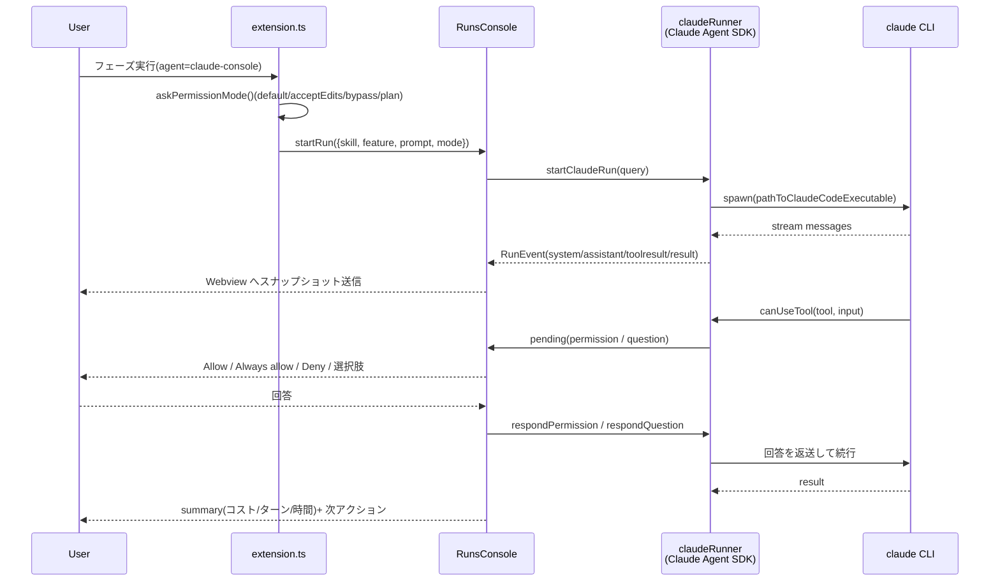

# エージェント呼び出しと Runs コンソール

## エージェントモード(`ccSdd.agent`)

`runSkill()`(`launch/agentLauncher.ts`)が設定に応じて起動方法を切り替えます。

| 値 | 動作 |
| --- | --- |
| `claude` | 新規ターミナルで `claude "/kiro-… <feature>"` を実行(Enter まで自動) |
| `claude-vscode` | Claude Code for VS Code パネルの composer にプロンプトを**補完**(自動送信はしない) |
| `claude-console` | 内蔵 **Runs コンソール**で headless 実行(Claude Agent SDK)。権限確認と `AskUserQuestion` をコンソール UI で処理 |
| `codex` | ターミナルで `codex "$kiro-… <feature>"` |
| `copilot` | `workbench.action.chat.open` で Copilot Chat にプロンプトを流し込む |
| `opencode` | ターミナルで `opencode run "/kiro-… <feature>"` |
| `custom` | `ccSdd.customCommand` のテンプレート(`${prompt}` / `${skill}` / `${feature}`) |
| `clipboard` | プロンプトをクリップボードへ |

プロンプト生成は `core/invocation.ts`。Claude 系は `/skill feature`、Codex は `$skill feature`。

### claude-vscode のフォールバック

1. `vscode.commands.executeCommand('claude-vscode.editor.open', undefined, prompt, …, { programmatic: 'honor-preferred-location' })`
2. 失敗時: URI `vscode://anthropic.claude-code/open?prompt=…` を `env.openExternal`
3. 失敗時: クリップボードへコピー + 警告

`honor-preferred-location` により、Claude Code 拡張側で「Open in Side Bar」を好みにしていればサイドバーへ流れます。

## Runs コンソール(`claude-console`)

### 対話画面

Runs は assistant-ui の React コンポーネントで会話を表示します。`webview/runs.tsx` の ExternalStoreRuntime が、拡張からの状態・履歴を受け取り、追加指示・停止・質問回答・権限確認を既存の `postMessage` 経路へ返します。HTTP サーバーや Assistant Cloud は不要です。

ツール実行ログは画面に表示しません。実行と権限確認は従来どおり Claude Agent SDK が担当し、トレースにも情報を残します。質問は複数選択・自由入力に対応します。実行終了後は同じセッションへ追加指示を送れます。

### 全体フロー

### SDK 統合(`run/claudeRunner.ts`)

`startClaudeRun(options)` が `query()` を呼びます。

| オプション | 値 |
| --- | --- |
| `prompt` | `/skill feature`(または再開時の継続メッセージ) |
| `cwd` | ワークスペースルート |
| `permissionMode` | `default` / `acceptEdits` / `bypassPermissions` / `plan` |
| `canUseTool` | 権限・質問コールバック(下記) |
| `pathToClaudeCodeExecutable` | `ccSdd.claudePath` を PATH から解決した絶対パス |
| `resume` | セッション再開時の session id |

補足:

- SDK は `claude` CLI を子プロセスとして使う。拡張は SDK を esbuild でバンドルするが、CLI はユーザー環境のものを使う(認証・設定を共有)
- `--dangerously-skip-permissions` は使わない。`bypassPermissions` は SDK の permission mode で指定
- `bypassPermissions` では SDK が `canUseTool` を呼ばない(警告が出る)。それ以外では呼ばれる

### 権限と質問(`canUseTool`)

- `AskUserQuestion` の場合
  - `input.questions` を検証して `AskUserQuestionSpec[]` に変換(選択肢 0 件の質問は無視)
  - `RunEvent { kind: 'pending', pending: { kind: 'question', questions } }` を発火して Promise で待機
  - UI が回答(question → label のマップ)を返すと `{ behavior: 'allow', updatedInput: { ...input, answers } }`
- その他のツールの場合
  - 実行中の許可セット(`always allow` で追加)に含まれれば即 allow
  - それ以外は `pending { kind: 'permission', toolName, summary }` を発火して待機
  - `deny` → `{ behavior: 'deny', message }`、`always` → セットに追加して allow
- キャンセル時は保留中の Promise を `deny` で解決し、`query.interrupt()` を呼ぶ

### イベントと状態

`RunEvent`(SDK メッセージ → 内部表現):

| SDK メッセージ | RunEvent |
| --- | --- |
| `system` (`subtype: init` のみ) | `{ kind: 'system', sessionId, model }`(hook 等の system は無視) |
| `assistant` の `text` ブロック | `{ kind: 'assistant', text }` |
| `assistant` の `tool_use` ブロック | `{ kind: 'assistant', tool: { name, summary } }` |
| `user` の `tool_result` ブロック | `{ kind: 'toolresult', text, isError }` |
| `result` | `{ kind: 'result', isError, text, costUsd, turns, durationMs }` |

`RunState`: `status`(`running` / `done` / `error` / `cancelled` / `preview`)、`segments`、`summary`、`pending`、`history`、`preview`。

上限:

| 対象 | 上限 |
| --- | --- |
| ログ segment 数 | 600(古いものから破棄) |
| ツール結果 1 件 | 1,200 文字 |
| 最終結果 | 4,000 文字 |
| 履歴(セッション) | 1,500 エントリ |

### 実行状態はどう決まるか

- `result` メッセージで `summary.isError = is_error || subtype !== 'success'` を決める
- ストリームが終了したら `onExit(exitCode, interrupted)`:
  - `interrupted`(Cancel)→ `cancelled`
  - `exitCode === 0 && !summary.isError` → `done`
  - それ以外 → `error`
- **`result` が来ずにストリームが閉じた場合は ERROR**(「done なのに summary が無い」を防ぐ)
- `stop_reason` は状態判定には使わず、RunSummary とトレースに保存する
- この `RunState.status` は Runs コンソールと `RunsStatusBar` が使う。別ウィンドウのセッションは Runs の状態を持たないため、[04-sessions.md](./04-sessions.md) のトランスクリプト末尾による `activity` 推定を Sessions ビューで使う

### Webview プロトコル(`ui/runsConsole.ts`)

**host → webview**

| type | 内容 |
| --- | --- |
| `state` | `RunState[]` のスナップショット。**`history` は含めない**(転送量削減) |
| `history` | `{ runId, segments }`。run ごと・パネルごとに**一度だけ**送信 |

**webview → host**

| type | 内容 |
| --- | --- |
| `ready` | 初期化完了。スナップショット+履歴を要求 |
| `cancel` / `continue` | 停止 / 完了したセッションへの追加指示 |
| `permission` | `{ pendingId, decision: allow \| always \| deny }` |
| `answer` | `{ pendingId, labels: string[] }`(質問への回答) |
| `approve` / `runPhase` / `runImpl` | 実行後のフェーズ操作 |
| `resumeConsole` / `resumeTerminal` | プレビューカードからのセッション再開 |

その他:

- 1 Run = 1 タブ。`panels: Map<WebviewPanel, runId>` で管理し、同じ Run やセッションは既存タブを再利用。タブ名は Spec 名と工程名
- 更新は 80ms で合流(`updateAll` のタイマー)
- Webview の CSP は nonce 付き。`style-src` のみ `'unsafe-inline'` を許可
- 保存済み履歴はプレビュー/再開時に会話へ変換して表示。React が状態更新を反映する
- `rerun` / `close` / `copy` / `openArtifact` / `overview` / `trace` のホストハンドラーは残るが、現在の画面からは送信しない

### RunsStatusBar / Overview との連携

ローカル run の状態は Runs タブ・`RunsStatusBar`・Specs・Sessions が使います。Overview の報告集計はリポジトリの記録に限定します。

| API | 用途 |
| --- | --- |
| `getRuns(): RunState[]` | スナップショット。サイドバーと RunsStatusBar のために `history` を落とす |
| `onDidChange` | `updateAll()` のたびに発火。RunsStatusBar とサイドバーの実行状態更新、および Overview の再取得に使う |
| `openRun(runId)` | run 専用タブを開く |
| `openOverview` オプション | 既存ホストハンドラー用。現在の Runs 画面にはボタンなし |

- run は**このウィンドウのメモリ**にのみ保持。通常は履歴30件を上限に整理するが、実行中・入力待ち・開いているタブは削除しない。再起動でメモリ内の記録は消える
- Overview は `spec.json` / `tasks.md` / `impl-validation.md` の記録を集計し、ローカル Run 状態は報告へ含めない(詳細は [06-overview.md](./06-overview.md))
- ステータスバーの `N waiting · M running` は `onDidChange` のたびに `getRuns()` から数え直し、クリックで Run 選択メニューを開く（入力待ちを優先。1件なら直接開く）

### コンソールの描画

- `webview/runs.tsx` が assistant-ui の Thread / Message / Composer を構成し、`webview/messages.ts` が履歴と RunSegment をメッセージへ変換する
- アシスタント出力は react-markdown + remark-gfm で見出し・箇条書き・表・コードブロックなどを表示。リンクはテキスト化し、画像は表示しない
- ユーザー発言は背景付きで区別し、ツール呼び出し・ツール結果・system セグメントは表示しない
- 実行中は `Claude is working…`、入力待ちは `Waiting for your response…` と表示
- 質問カードはラジオボタン・チェックボックス・自由入力に対応し、すべての質問に回答して上矢印アイコンで送信する。権限確認は一度だけ許可 / 常に許可 / 拒否のアイコンを表示
- 承認可能なフェーズでは承認 / 次フェーズ実行 / 実装実行のアイコンを表示(`getPhaseActions`)
- 入力欄は角丸の一体型。左下に説明付き権限メニュー、右下に送信(上矢印) / 再開(再生) / 停止(四角)を配置。モデル選択は設けない
- ボタンは透明な背景の Lucide アイコン。操作名はツールチップと aria-label で伝える。権限メニューは現在のモード名と説明を表示する
- Overview / Save trace / Re-run / Open artifact ボタンは表示しない。タブを閉じても記録と実行を維持し、停止は四角アイコンで行う

### 完了後の継続(Continue)

完了した Run の入力欄から追加指示を送り、`resume: <sessionId>` の新しいクエリを同じタブで開始します。過去の会話を保持し、追加指示はユーザー発言として追記します。質問カードの回答待ち・実行中は通常の会話入力を無効にします。

セッションのプレビューでは、入力欄の左下で権限モードを選び、再生アイコンで Runs 内の実行を再開します。ヘッダーのターミナルアイコンから対話ターミナルでも再開できます。

### 使用量とデバッグ

- 入力欄の上にモデル名、入力 / 出力トークン、キャッシュ読み取り、コストを表示。完了時は summary の usage / cost を優先する
- ターン別 usage、キャッシュ書き込み、権限拒否件数などは内部状態とトレースに保持するが、現在の画面に専用の表や統計行は表示しない
- コマンドパレットの `cc-sdd: Save Last Run Trace` で最新 Run を保存する。出力先は `.kiro/runs/<timestamp>-<skill>-<feature>.json`。実行中の保存はその時点のスナップショット(`snapshot: true`)
- セッションプレビューの履歴や usage も RunState に保持され、最新 Run のトレースに含まれる

### 権限モードの既定

`ccSdd.consolePermissionMode`(既定 `default`)を QuickPick の初期選択に使います。`default` は「コンソールで都度確認」、`acceptEdits` は編集のみ自動許可、`bypassPermissions` は全許可、`plan` は読み取り専用です。
