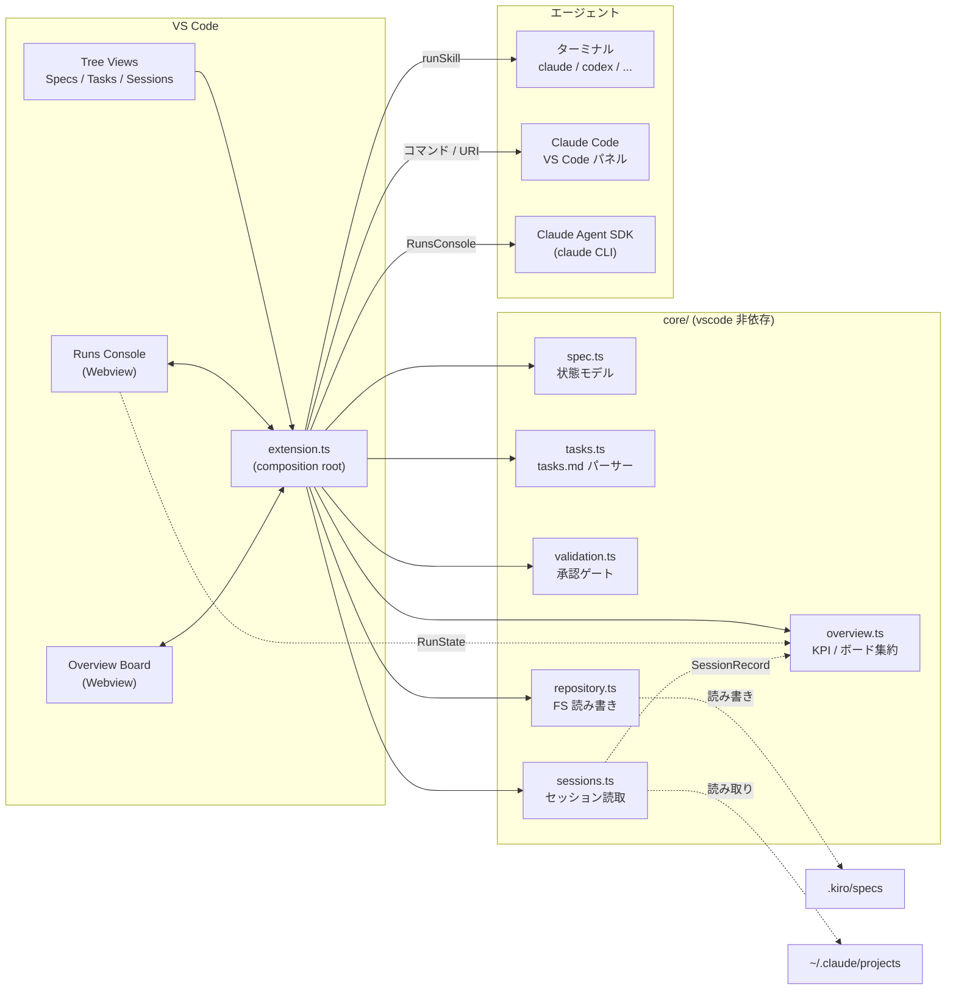

# cc-sdd Specs 拡張機能 — ドキュメント

このディレクトリは、`cc-sdd-vscode` 拡張機能の**現在の作り**を第三者が理解するための設計ドキュメントです。
cc-sdd 自体の説明は [cc-sdd リポジトリ](https://github.com/gotalab/cc-sdd) を参照してください。
内容は **0.8.1** 時点の実装に合わせています。

## これは何か

VS Code 上で cc-sdd の Spec-Driven Development を回すためのワークベンチです。

- `.kiro/specs/<feature>/` の状態(`spec.json`)と成果物(`requirements.md` / `design.md` / `tasks.md`)を読み取って UI 化する
- 承認ゲート(生成物の検証)と状態遷移は**拡張機能側**が持つ
- スキルの実行(実際の生成)は**外部エージェント**に委譲する
  - ターミナルの `claude` / Codex / OpenCode
  - Claude Code for VS Code のパネル
  - 拡張内蔵の **Runs コンソール**(Claude Agent SDK 経由の headless 実行)
  - Copilot Chat / カスタムコマンド / クリップボード
- 過去の Claude Code セッションを一覧・プレビュー・再開できる(**Sessions**)
- 複数の run / セッション / spec を 1 画面で俯瞰できる(**Overview** ボード)

「生成はエージェント、承認と状態遷移は拡張」が設計の中心です。

## 読む順

| # | ドキュメント | 内容 |
| --- | --- | --- |
| 1 | [01-architecture.md](./01-architecture.md) | 全体アーキテクチャ、レイヤ、起動とデータフロー、拡張ポイント |
| 2 | [02-spec-state.md](./02-spec-state.md) | `spec.json` の状態モデル、承認ゲート、`tasks.md` / steering / roadmap |
| 3 | [03-agents-and-runs.md](./03-agents-and-runs.md) | エージェント呼び出し、Claude Agent SDK ランナー、Runs コンソール(Webview) |
| 4 | [04-sessions.md](./04-sessions.md) | Claude Code セッションの保存形式、一覧・絞り込み、プレビュー、再開 |
| 5 | [05-development.md](./05-development.md) | ビルド/テスト/パッケージ/リリース、既知の落とし穴、拡張手順 |
| 6 | [06-overview.md](./06-overview.md) | リーダー / PM 向け Overview ボード（KPI / Kanban / spec ポートフォリオ） |

## 全体像

## 用語

| 用語 | 意味 |
| --- | --- |
| spec / feature | `.kiro/specs/<feature-id>/` 1 つ分の単位 |
| phase | `requirements` → `design` → `tasks` の 3 フェーズ |
| approval | フェーズ成果物の承認状態(`spec.json` の `approvals`) |
| gate | 承認前に走る成果物の検証。error はブロック、warning は確認付きで許可 |
| skill | cc-sdd が配布する `/kiro-*` スキル(例: `/kiro-spec-design`) |
| agent | スキルを実行する外部ツール(Claude Code 等) |
| run | Runs コンソール上の 1 回の headless 実行 |
| session | Claude Code が `~/.claude/projects/` に保存する会話ログ |
| overview | ライブ run / 作業中セッション / 承認待ち / spec 進捗をまとめたリーダー向けボード |
